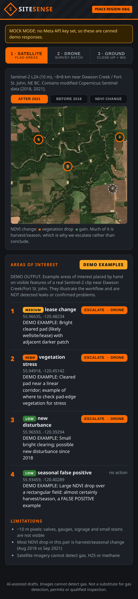
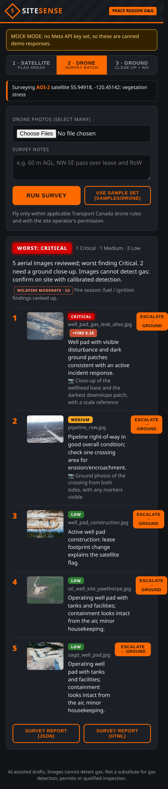
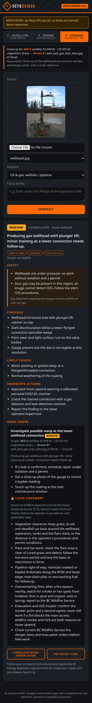
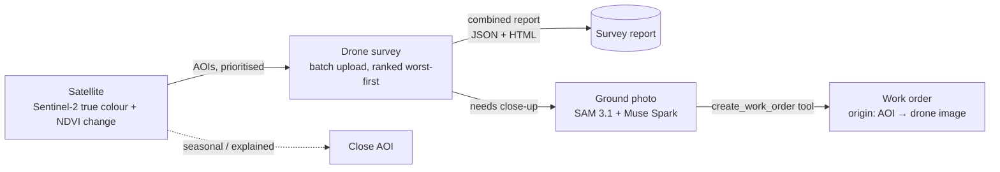

# SiteSense

Multimodal agentic field assistant for the **Meta Global AI Developer Hackathon** (Oct 26–Nov 4, 2026).

**Focus: oil & gas wellsite and pipeline inspection in the Peace Region (Dawson Creek, BC).** A lease operator photographs a wellhead, flange, gauge or stain on a phone. Before they leave the pad, SiteSense returns a severity-rated finding, safety-first actions (including H2S cues) and a ready-to-file work order.

Uses the Meta Model API:
- **SAM 3.1**: object segmentation
- **Muse Spark 1.3**: structured diagnosis + tool-calling agent loop

| 1 · Satellite | 2 · Drone | 3 · Ground |
|---|---|---|
|  |  |  |

## Three-level inspection: Satellite → Drone → Ground
1. **Satellite** (free Sentinel-2, 10 m): screen a whole area for *areas of interest*: new clearings or lease changes, vegetation stress along a right-of-way (NDVI before/after), dark patches. It's cheap and wide, but can't see components or gas.
2. **Drone**: fly the flagged AOI and upload the whole batch at once. SiteSense ranks every shot **worst-first** and builds one combined survey report (JSON + printable HTML), saying which spots need a ground close-up and what to photograph.
3. **Ground** (phone): the close-up. The existing flow returns a structured diagnosis plus a tool-called **work order that links back** to its origin (Satellite AOI → Drone image → Ground).



Every mode has its own prompt (`prompts/satellite_system.txt`, `prompts/drone_system.txt`, `prompts/oil_gas_system.txt`) that is explicit about resolution limits. All three keep the rule that **images cannot detect gas**.

> **Satellite demo data:** the bundled clip is a real Sentinel-2 scene near Dawson Creek / Fort St. John, but the areas of interest in mock mode are **hand-placed demo examples, not detected leaks**. Much of the NDVI drop in that pair is harvest or seasonal change, which is exactly why SiteSense escalates instead of concluding.

### Drone flights: rules and permission
- Fly only within applicable **Transport Canada** drone rules: the right pilot certificate for the operation, a registered drone, visual line of sight, altitude limits, airspace authorization where required, and distance from people and aerodromes. Check current rules on the Transport Canada website before flying.
- Get the **site operator's / landowner's permission** before flying over leases, facilities or right-of-ways, and follow the company's site-entry, H2S and flight procedures.
- SiteSense never recommends flying outside these rules.

## Why oil & gas in the Peace Region
- Thousands of wellsites, pipelines and facilities are spread over remote leases, often checked by one operator per route.
- Findings are often written up hours later from memory. SiteSense turns a photo + a note into a consistent, structured record on the spot.
- Safety-first by design: H2S/sour-gas cues are flagged, and the model **never claims to detect gas from an image**. It always calls for calibrated gas detection.
- Regulatory context stays generic ("follow your company's procedures and applicable BC Energy Regulator requirements"), with no invented regulation numbers.

## What it does
Point a camera at equipment, a crop, or a defect → get a structured diagnosis, severity rating, immediate actions, and a ready-to-use work order.

Oil & gas mode (default in the web demo) also looks at leaks/stains, corrosion and pitting, valves and wellheads, flanges and gaskets, pressure gauges (only legible readings), tank/berm containment, signage, PPE, H2S cues and hot work. It adds `asset_type`, `hazard_flags`, `gauge_reading`, `requires_gas_detection` and `regulatory_note` to the output.

## Quick start
1. Get a key from [dev.meta.ai](https://dev.meta.ai) and export it:
   ```bash
   export MODEL_API_KEY="your_key_here"
   ```
2. Install dependencies:
   ```bash
   pip install -r requirements.txt
   ```
3. Run:
   ```bash
   python sitesense.py
   ```
   (Update `IMAGE_PATH` inside the script first, or pass a path: `python sitesense.py samples/wellhead.jpg`.)

### No key yet? Mock mode
If `MODEL_API_KEY` is unset (or `SITESENSE_MOCK=1`), SiteSense returns realistic canned diagnoses, so the whole demo runs end to end:
```bash
pip install -r requirements.txt
python sitesense.py samples/corroded_pipe.jpg      # CLI
uvicorn app.main:app --reload --port 8000          # web demo → http://localhost:8000
```
Open the page on your phone (same Wi-Fi, `--host 0.0.0.0`) to use the camera directly.

### Real mode
```bash
export MODEL_API_KEY="..."                         # from dev.meta.ai
export MODEL_API_BASE_URL="https://api.meta.ai/v1" # default; confirm on dev.meta.ai
# optional overrides if the model IDs differ:
export SITESENSE_SEG_MODEL="sam-3.1" SITESENSE_LLM_MODEL="muse-spark-1.3"
uvicorn app.main:app --port 8000
```

### Three-level demo (CLI)
```bash
python sitesense.py --satellite              # demo AOIs (mock) / satellite screening (real)
python sitesense.py --drone samples/drone    # batch survey, worst-first
python sitesense.py samples/leak_stain_soil.jpg
```
Swap in your own drone photos by dropping them into `samples/drone/` (see `samples/drone/README.md`), or multi-select them in the Drone tab.

Refresh the satellite clip (free, no auth; Element84 Earth Search STAC → AWS COGs):
```bash
pip install rasterio numpy pillow pyproj
python tools/fetch_sentinel.py
```

### Tests
```bash
pip install -r requirements-dev.txt
pytest -q
```

## Demo flow
1. SAM 3.1 segments the object of interest
2. Muse Spark returns a structured JSON diagnosis (oil & gas prompt + schema when that domain is selected)
3. Second agent call finalizes a work order via tool calling
4. The web UI shows a severity badge, findings, safety notes and the work order, and offers it as JSON or printable (PDF-ready) HTML
5. Upstream of this, the satellite screening and drone batch survey choose *where* the ground photo gets taken (see the three-level section)

## Architecture
```
 Phone camera / upload ──► FastAPI (app/main.py) ──► sitesense.run_pipeline()
                                                      │
                     ┌────────────────────────────────┼─────────────────────────────┐
                     ▼                                ▼                             ▼
          segment_image()  SAM 3.1         diagnose()  Muse Spark 1.3      create_work_order()
          (object mask/box)                prompts/oil_gas_system.txt      tool call: create_work_order
                                           schemas/oil_gas_diagnosis.json  
                     └──────────── MOCK mode (mock_data.py) when no key ───────────┘
                                                      │
                               JSON ◄── severity · findings · safety · work order ──► HTML/PDF
```

| Path | Purpose |
|---|---|
| `sitesense.py` | Core pipeline + CLI (original flow kept; lazy client; mock switch) |
| `mock_data.py` | Canned corrosion / wellhead / gauge / spill scenarios |
| `prompts/`, `schemas/` | General and oil & gas prompts and JSON schemas |
| `app/` | FastAPI app + mobile page (Satellite / Drone / Ground tabs); `/api/satellite/demo`, `/api/drone`, `/api/drone/report.html`, `/api/diagnose`, `/api/work_order.html` |
| `samples/` | Ground demo photos (public domain) |
| `samples/satellite/` | Sentinel-2 clips, NDVI change, demo AOIs (`tools/fetch_sentinel.py`) |
| `samples/drone/` | CC BY / CC BY-SA aerial stand-ins; drop your own drone photos here |
| `tools/` | Data-fetch scripts |
| `tests/` | pytest for the mock pipeline and API |

## Hackathon fit
- Theme: “Build for Your World” + “Push the Frontier”
- Uses Muse Spark 1.3 + SAM 3.1
- $150 Meta Model API credits for accepted participants

### Judging-criteria checklist
- [x] **Real-world impact**: local, specific problem (Peace Region wellsite/pipeline inspection)
- [x] **Use of Meta models**: SAM 3.1 segmentation + Muse Spark structured output + tool calling
- [x] **Agentic behaviour**: multi-step pipeline ending in a tool-generated work order
- [x] **Frontier / multi-scale**: Satellite → Drone → Ground escalation with traceable work orders
- [x] **Working demo**: mobile web app, runs without a key (mock), tests pass
- [x] **Responsible AI**: never claims gas detection, reads only legible gauges, no invented part or regulation numbers, human sign-off on work orders
- [ ] **Live run on Meta Model API**: pending API key (verify endpoint shapes)
- [ ] **Demo video** (2–3 min: phone on a real lease → work order)
- [ ] **Offline/low-signal story** (queue photos, sync later)

## Known assumptions
- The SAM 3.1 call (`client.responses.create`) and its response shape are **unverified**. Confirm them on dev.meta.ai.
- It assumes an OpenAI-compatible Muse Spark endpoint that supports `response_format` `json_schema` and `tools`.
- Model IDs `sam-3.1` / `muse-spark-1.3` are placeholders until confirmed.
- Satellite and drone real-mode calls assume Muse Spark accepts multiple images per message and `json_schema` output. The satellite schema uses a nullable `["number","null"]` type, which some strict-mode implementations may reject.
- Bundled drone images are aerial stand-ins (mostly from crewed aircraft, some outside BC) until Barbara's own drone photos replace them.
